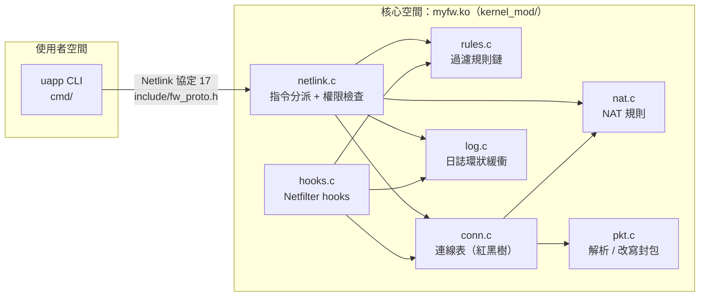
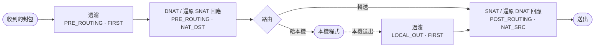

# myfw：Linux 核心狀態防火牆（Netfilter + Netlink）

以 Linux kernel module 實作的 IPv4 防火牆，具備封包過濾、真正雙向的連線狀態追蹤、SNAT（來源 NAT／偽裝）與 DNAT（port forwarding），並透過 Netlink 由命令列工具 `uapp` 控制。

本專案改寫自 [jujuegg/FireWall](https://github.com/jujuegg/FireWall)（其前身為 RicheyJang 的 RJFireWall）。修正了原版的多個錯誤，補上新功能，並附上可在 QEMU 虛擬機中一鍵執行的完整測試（88 項全數通過，見[測試](#測試)）。

## 功能

| 功能 | 說明 |
|---|---|
| 封包過濾 | 依來源/目的 IP（CIDR）、來源/目的 port（單一或範圍）、協定（TCP/UDP/ICMP/any）比對，first-match，可設 accept/drop |
| 規則管理 | 新增（插在最前、最後、或某條規則之後）、刪除、清空、列出；每條規則都有命中封包數／位元組數 |
| 預設策略 | `accept`（黑名單模式）或 `drop`（白名單模式），可選擇記錄預設策略處理的封包 |
| 連線狀態 | 已放行連線的**雙向**流量自動通過；白名單模式下不必為回應封包寫反向規則。TCP/UDP/ICMP 各自有逾時，TCP 遇到 FIN/RST 會縮短逾時 |
| SNAT | 內網網段經防火牆往外時，改寫來源 IP，並從指定範圍分配 port（盡量保留原 port） |
| DNAT | 對外 IP:port 轉送到內部主機（port forwarding），TCP 與 UDP 皆支援 |
| 日誌 | 環狀緩衝區最多 1000 筆，記錄正確的日期時間、動作，以及是哪條規則或預設策略 |
| 存檔/載入 | `uapp save` 把整份規則集輸出成指令，`uapp load` 原樣還原 |
| 權限 | 只有 root（`CAP_NET_ADMIN`）能控制防火牆 |
| 可調參數 | 逾時時間、連線表上限都是 module 參數 |

## 架構



`include/fw_proto.h` 是核心與 `uapp` **共用的唯一一份**通訊協定定義。原版在兩個地方各寫一份，兩邊已經不一致。

### 封包流程



- **每個封包只被過濾一次**，而且一定在任何位址改寫之前，所以規則永遠以傳送端看到的原始位址來寫。
- 過濾流程：先查連線表（雙向都算），命中就直接放行；否則依序比對規則，都不符合時走預設策略；放行的話建立新連線。

### 連線表的設計（`conn.c`）

每條連線存兩個 tuple，與 Linux conntrack 的作法相同：

```
一般連線     orig  10.0.1.2:5000 -> 10.0.2.2:80      reply 10.0.2.2:80 -> 10.0.1.2:5000
SNAT 後      orig  10.0.1.2:5000 -> 10.0.2.2:80      reply 10.0.2.2:80 -> 10.0.2.1:20345
DNAT 後      orig  10.0.2.2:6000 -> 10.0.2.1:8080    reply 10.0.1.2:2222 -> 10.0.2.2:6000
```

兩個 tuple 都索引在同一棵紅黑樹裡，所以不論封包從哪個方向來，都能 O(log n) 查到它屬於哪條連線、哪個方向。NAT 本身就只是「改寫 reply tuple」：回程封包靠 reply tuple 找到連線，再依 orig tuple 把位址改回去。SNAT 分配 port 時，只需確認新的 reply tuple 沒被占用。

所有連線表操作都在同一把 `spin_lock_bh` 裡完成（封包路徑可能在 softirq，也可能在 process context 的 LOCAL_OUT），由 kernel timer 每秒清除逾時的連線。

## 目錄結構

```
include/fw_proto.h     核心與 uapp 共用的 Netlink 協定
kernel_mod/            核心模組 myfw.ko
  mod_main.c             載入/卸載、module 參數
  hooks.c                4 個 Netfilter hook 與過濾邏輯
  pkt.c                  封包 tuple 解析、NAT 改寫與增量 checksum
  rules.c / nat.c        過濾規則鏈 / NAT 規則
  conn.c                 連線表（雙 tuple 紅黑樹、逾時回收、NAT 狀態）
  log.c                  日誌環狀緩衝
  netlink.c              控制通道（含 CAP_NET_ADMIN 檢查）
cmd/                   uapp 命令列工具
test/e2e.sh            端對端測試（88 項）
test/fwtest.c          測試用的 echo 伺服器 / 客戶端，會逐 byte 驗證回傳資料
test/vm/run.sh         建立 QEMU 虛擬機並在其中跑 e2e.sh
TestScript/            手動測試用的 Python UDP 收發腳本
```

## 安裝

需求：Ubuntu 24.04（kernel 6.8；6.17 也已測試）、`build-essential`、對應版本的 headers。

```bash
sudo apt install build-essential linux-headers-$(uname -r)
git clone https://github.com/adamboy447/Linux-FireWall && cd Linux-FireWall
make                      # 編譯 kernel_mod/myfw.ko 與 cmd/uapp
sudo make load            # insmod；要帶參數：sudo make load OPTS="udp_timeout=30"
sudo ./cmd/uapp status
sudo make unload          # rmmod
sudo make install         # 選用：uapp 裝到 /usr/local/sbin，模組可用 modprobe myfw 載入
```

> 建議先在虛擬機裡玩。在遠端主機上設 `rule default drop` 之前，**先加一條放行自己 SSH 的規則**。
> 如果開了 Secure Boot，未簽章的模組會被拒絕（`Key was rejected by service`），需要關閉 Secure Boot 或自行簽章。

## 使用

所有指令都要 root。執行 `uapp help` 可以看完整說明。

```bash
# 狀態總覽
sudo uapp status

# 黑名單：擋掉對 10.0.2.2 的 UDP 9000，並記錄
sudo uapp rule add --name no-udp --dst 10.0.2.2 --dport 9000 --proto udp --action drop --log

# 白名單：預設全擋，只開 SSH 和 web
sudo uapp rule add --name ssh --dport 22 --proto tcp --action accept
sudo uapp rule add --name web --src 10.0.1.0/24 --dport 80-443 --proto tcp --action accept --log
sudo uapp rule default drop --log        # 回應封包靠連線狀態自動放行

# 規則順序：--head 插到最前面，--after NAME 插在某條規則後面（預設加到最後）
sudo uapp rule add --name allow-me --src 10.0.1.2 --action accept --head

sudo uapp rule ls                        # 列出規則（含命中數）
sudo uapp rule del web                   # 刪除（同名規則全部刪除）
sudo uapp rule flush
sudo uapp rule add                       # 不帶參數 = 原版的互動式輸入

# SNAT：讓 10.0.1.0/24 透過本機的 10.0.2.1 上網
sudo sysctl -w net.ipv4.ip_forward=1
sudo uapp nat add --type snat --src 10.0.1.0/24 --to 10.0.2.1 --ports 20000-30000

# DNAT：外部連 10.0.2.1:8080 轉給內部 10.0.1.2:80
sudo uapp nat add --type dnat --dst 10.0.2.1 --dport 8080 --proto tcp --to 10.0.1.2:80
sudo uapp nat ls
sudo uapp nat del 0

# 觀察
sudo uapp log 20                         # 最近 20 筆
sudo uapp conn                           # 連線表（NAT 連線會顯示 reply tuple）
sudo uapp log clear ; sudo uapp conn flush

# 存檔 / 還原
sudo uapp save /etc/myfw.rules
sudo uapp load /etc/myfw.rules           # 先清空規則與 NAT，再逐行套用
```

原版的短指令（`uapp ls rule|nat|log|connect`）都還能用。

輸出範例（取自測試紀錄）：

```
$ uapp rule ls
#   name            source             sport       destination        dport       proto action log    packets        bytes
0   allow-cli       10.0.1.2           any         any                9000        udp   accept no           1           40
1   mid             any                any         any                1234        tcp   drop   no           0            0
2   no-udp9000      any                any         10.0.2.2           9000        udp   drop   yes          1           40

$ uapp log
[2026-10-24 12:49:05] DROP   udp         10.0.1.2:57174 -> 10.0.2.2:9000         len=40    rule=no-udp9000

$ uapp conn
proto original direction                            nat   expires  packets (orig/reply)
tcp   10.0.1.2:57396 -> 10.0.2.2:80                 SNAT      10s   301/297
      reply: 10.0.2.2:80 -> 10.0.2.1:20198
```

### Module 參數

| 參數 | 預設 | 說明 |
|---|---|---|
| `tcp_timeout` | 300 | TCP 連線閒置逾時（秒） |
| `tcp_close_timeout` | 10 | 看到 FIN/RST 後的逾時 |
| `udp_timeout` | 60 | UDP 連線閒置逾時 |
| `icmp_timeout` | 30 | ICMP 及其他協定的逾時 |
| `max_conns` | 16384 | 連線表上限（滿了以後新封包仍依規則放行，只是不建立狀態） |

例如 `sudo insmod kernel_mod/myfw.ko udp_timeout=30`，執行中也可以改 `/sys/module/myfw/parameters/*`。

## 測試

```bash
sudo apt install qemu-system-x86 busybox-static cpio zstd
sudo make test           # 或 sudo KVER=6.17.0-42-generic ./test/vm/run.sh
```

`test/vm/run.sh` 會用 Ubuntu 的 kernel 開一台 QEMU 虛擬機（只有 initramfs，不碰主機網路），在裡面用 network namespace 架出：

```
[client ns] 10.0.1.2 ── veth ── 10.0.1.1 [router：載入 myfw] 10.0.2.1 ── veth ── 10.0.2.2 [server ns]
```

然後執行 `test/e2e.sh` 的 88 項檢查，在 kernel 6.8.0-147 與 6.17.0-42 上都全數通過：

| 段落 | 驗證內容 |
|---|---|
| 1–2 | 載入模組；一般使用者（nobody）無法查詢或修改規則 |
| 3–5 | 預設放行；黑名單（區分 TCP/UDP 與 port）；日誌日期正確；命中計數；`--head`/`--after` 的 first-match 順序 |
| 6 | 白名單：只開 client→server tcp/80，回應不需反向規則；2 MB 傳輸完整；其他 port、ping、反向連線都被擋；本機送出的流量也會被過濾 |
| 7–8 | UDP 連線依 `udp_timeout` 逾時；新增 drop 規則會切斷已建立的連線 |
| 9–11 | save → flush → load 後規則集完全相同；互動式新增；錯誤輸入（IP、port、協定、名稱長度）都會被拒絕 |
| 12 | 拿掉 server 的回程路由，證明沒有 SNAT 不通、加上 SNAT 就通；server 看到的是 NAT 位址與 pool 內的 port；TCP/UDP/ping 都可以；**8 MB 逐 byte 驗證**（checksum 與 GSO 正確） |
| 12b | 4 條 4 MB 的 NAT 連線傳輸期間，同時做 150 次規則增刪和 450 次查詢：資料完整、核心無錯誤 |
| 13 | DNAT：TCP/UDP port forwarding，內部主機看到的是真實外部位址；8 MB 逐 byte 驗證；刪除 NAT 規則後連線確實中斷 |
| 15–16 | rmmod 後 uapp 會提示模組未載入；可以重新載入；dmesg 沒有任何 BUG/WARNING/Oops |

## 相對於原版的修正

| 原版問題 | 影響 | 修正 |
|---|---|---|
| 連線狀態只認同一方向 | 白名單模式下回應封包被擋，必須自己寫反向規則 | 雙 tuple 連線表，雙向都能查到 |
| 日誌時間用 `ktime_get()`（開機後經過的時間） | 日誌日期顯示錯誤（1970 年附近） | 改用 `ktime_get_real_seconds()` |
| Netlink 沒有檢查權限 | 任何本機使用者都能改防火牆規則 | 要求 `CAP_NET_ADMIN`，並以 socket 的真實 port id 回覆 |
| 封包路徑（softirq）中用 `GFP_KERNEL` 配置記憶體 | 在 atomic context 中睡眠，可能讓核心當掉 | 封包路徑不再配置記憶體（日誌改為環狀緩衝），連線用 `GFP_ATOMIC` |
| 鎖：查到節點就放鎖再使用、讀鎖「升級」成寫鎖、沒有關 BH | use-after-free、紅黑樹損毀、softirq 與 process context 互相死結 | 統一使用 `spin_lock_bh`，整個操作在鎖內完成，只回傳複本 |
| NAT 直接對 `skb->data` 重算 checksum | 非線性 skb（GSO、大封包）資料損毀甚至越界 | `skb_ensure_writable` + `inet_proto_csum_replace*` 增量更新，也能處理 checksum offload |
| 讀 port 時沒確認 header 在線性區 | 可能讀到越界記憶體 | `skb_header_pointer` |
| 連線 key 沒有協定 | 同 port 的 TCP/UDP 被當成同一條連線 | key 加入協定 |
| 刪除 NAT 規則 0 時沒檢查空串列 | NULL pointer 造成核心 oops | 重寫 NAT 規則管理 |
| rmmod 不釋放規則、日誌、連線 | 記憶體洩漏，且 timer 可能在卸載後觸發 | 依序解除 hook、停止 timer、釋放所有資料 |
| 使用者端 request 沒清零、名稱可能沒有 `\0` | 核心讀到垃圾字串 | 使用者端清零，核心端強制結尾 |
| port 只輸入 `80`（不是 `80-80`） | 上限變成未初始化的值 | 支援 `80`、`80-90`、`any`，並檢查範圍 |
| IP 解析接受 256、不檢查格式 | 錯誤 IP 被默默接受 | 使用 `inet_pton` 並驗證 CIDR |
| 測試腳本 port 對不上（8080 vs 8000） | 腳本無法使用 | 修正並可帶參數 |

## 已知限制

- 只支援 IPv4，也只作用在初始 network namespace。
- 狀態追蹤以 flow 為單位，不驗證 TCP 序號或狀態機（例如不會擋掉沒有 SYN 的 ACK）。
- 不重組 IP 分片：非首片沒有 port 資訊，會依 port=0 比對規則。
- DNAT 只處理經過的封包，本機自己連自己的對外 IP 不會被轉送。
- 若同時載入了 Linux 的 `nf_conntrack`（例如有用 iptables/docker），兩者都會看封包；myfw 的 NAT 改寫可能讓 conntrack 把封包判為 INVALID。建議在乾淨環境使用。
- 規則存在記憶體中，重開機後需要用 `uapp load` 還原。

## 授權與致謝

AGPL-3.0（見 `LICENSE`），核心模組宣告為 GPL。原始設計來自 RicheyJang 的 RJFireWall，繁中化與 6.8 移植來自 jujuegg。
