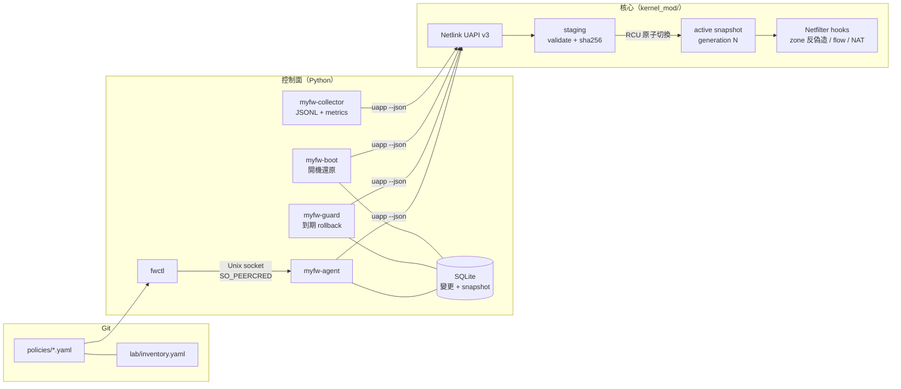

# myfw Ops：可驗證、可復原的 Linux 防火牆

自己寫的 Linux 核心防火牆（Netfilter + Netlink，狀態追蹤、SNAT/DNAT），加上一套讓「改規則」變安全的維運系統：

- **政策即程式碼**：YAML 放在 Git，套用前做 schema 與語意檢查（遮蔽規則、開放管理服務、NAT 不可達……）。
- **整份原子切換**：政策以 snapshot 送進核心，核心重新驗證後一次切換；沒有封包會一半用舊規則、一半用新規則。
- **確認或自動退回**：套用後立刻從各端點實際連線探測；探測失敗立即 rollback，沒有在期限內確認也會由獨立的 guard 退回，連重開機都會回到最後確認版。
- **出錯時拒絕，而不是放行**：flow 表滿、SNAT port 用完、狀態遺失都 DROP 並記錄原因。
- **看得到、查得出**：Prometheus 指標（收集失敗時不假裝成 0 流量）、有序號與遺失紀錄的事件日誌、能分辨「政策擋掉 / 路由壞了 / 服務沒開」的 `fwctl diagnose`。

> 這是在筆電 VM 裡的實驗系統，用來練習防火牆、自動化與維運設計；不是可直接上線的產品。限制見[最後一節](#限制)。

## 五分鐘看懂

```bash
fwctl validate policies/demo.yaml              # 離線檢查
fwctl diff policies/demo.yaml                  # 和線上差什麼、會不會重置連線
fwctl apply policies/demo.yaml                 # 原子 commit + 必要服務探測 → pending
fwctl confirm chg-20261108-012345-abc123       # 確認；不確認 60 秒後自動退回
fwctl verify                                   # 10 個存取矩陣探測
fwctl diagnose --from lan-client --to 10.10.20.10 --port 443 --check https
```

錯誤政策（誤刪內部存取規則）的實際輸出：

```
$ fwctl apply /tmp/broken.yaml
chg-20261108-021629-19f67e: committed generation 6 (gate 0.246 ms, 6 flow(s) reset)
  FAIL lan-to-dmz-https: expected allow, got timeout
  PASS lan-to-wan-https-snat: expected allow, got connected (server saw 192.0.2.1:20565)
  PASS wan-published-https: expected allow, got connected (server saw 192.0.2.10:50346)
  PASS wan-direct-to-dmz: expected deny, got timeout
  ...（其餘 6 個拒絕探測皆 PASS）
ROLLED BACK to d09d394b99f1fdb9 as generation 7: required service check failed: lan-to-dmz-https (by root)
```

完整展示流程：[docs/demo.md](docs/demo.md)。

## 架構



Lab：三個 network namespace（lan / dmz / wan）各接 gateway 一張 veth，外加一個管理介面。

| 路徑 | 預期 | 證據 |
|---|---|---|
| lan-client → dmz-web:443 | 允許 | HTTPS 回應 |
| lan-client → wan-host:443 | 允許（SNAT） | wan-host 看到 `192.0.2.1:2xxxx` |
| wan-host → 192.0.2.1:8443 | 允許（DNAT → dmz-web:443） | dmz-web 看到真實的 `192.0.2.10` |
| 其他 7 條（wan 直連 DMZ、DMZ → LAN、各區連管理 SSH…） | 拒絕 | 連線逾時 + drop 計數 |

詳細設計：[architecture](docs/architecture.md) · [policy semantics](docs/policy-semantics.md) · [transaction design](docs/transaction-design.md) · [observability](docs/observability.md)

## 政策範例

```yaml
rules:
  - id: lan-dmz-web
    ingress_zone: lan
    source: 10.10.10.0/24
    destination: 10.10.20.10/32
    protocol: tcp
    destination_ports: [443]
    action: accept
    owner: demo-web
    reason: "Internal users reach the HTTPS service"

nat:
  - id: publish-web
    type: dnat
    ingress_zone: wan
    destination: 192.0.2.1/32
    protocol: tcp
    destination_ports: [8443]
    to_address: 10.10.20.10
    to_port: 443
```

管理網路與管理服務的保護（baseline）由 inventory 自動產生，業務政策無法覆蓋；`policies/invalid/` 有 14 個會被拒絕的例子。

## 變更與復原

| 情況 | 結果 |
|---|---|
| 政策不合法 | 拒絕，核心完全沒被碰到 |
| 送進核心的 blob 被截斷 / 亂碼 / 寫到一半中斷 | 核心驗證失敗或釋放 staging，active 不變 |
| 兩個人同時套用 | 只有一個成功，另一個收到 conflict / pending |
| 必要服務探測失敗 | 立即 rollback（新 generation），`apply` exit 4 |
| 沒有在期限內確認 | guard 每秒檢查，到期即 rollback（TCG VM 兩次實測：期限後 1.2 秒、3.7 秒完成） |
| agent 被 kill -9 | 資料面照常；guard 仍會 rollback；systemd 重啟 agent |
| pending 時重開機 | 開機先套用最後確認版，之後才打開 forwarding |
| 語意相同的政策重新套用 | no-op，不 commit、不重置連線 |

## 驗證證據

| 測試 | 規模 | 結果 |
|---|---|---|
| 控制面單元測試（`control/tests`） | 46 項，含 C / Python ABI 交叉比對 | 全數通過（Python 3.10 / 3.12 / 3.13） |
| 核心 e2e（`test/e2e.sh`，QEMU initramfs VM） | 134 項 | 6.8 與 6.17 皆 134/134 |
| VM 整合測試（`test/integration`，完整 systemd 部署） | 26 項 | 26/26 |
| pending 中重開機（`test/integration/reboot_pending.py`） | 1 項 | 通過 |
| Ansible 冪等 | 第二次執行 | `changed=0` |
| 政策檢查（`test/ci/check-policies.sh`） | 1 合法 + 14 不合法 | 全數符合預期 |
| 告警單元測試（`promtool test rules`） | 4 條告警情境 | 由 CI 執行 |

完整紀錄：[docs/test-report.md](docs/test-report.md)。CI（`.github/workflows/ci.yml`）在每次 push 跑單元測試、政策檢查、告警測試、`-Werror` 編譯，以及 QEMU 裡的 e2e。

效能對照（同一個 VM、lan → wan 經 SNAT，5 次的中位數與範圍；QEMU TCG 模擬，**只能比較相對差異**）：

| 方案 | TCP 吞吐量 Mbit/s | 相對 baseline | 新連線/秒 | 相對 baseline |
|---|---|---|---|---|
| baseline（純路由，無過濾無 NAT） | 967（890–1074） | — | 1150（976–1308） | — |
| nftables 等價政策 | 848（778–881） | 88% | 876（845–956） | 76% |
| 原版 myfw（main） | 960（850–1052） | 99% | 1001（935–1024） | 87% |
| v2 資料面（控制面停止） | 935（890–956） | 97% | 974（903–1022） | 85% |
| v2 完整部署 | 815（720–850） | 84% | 976（457–1044） | 85% |

v2 的核心路徑和原版幾乎一樣快；完整部署的差距來自控制面和轉發搶同一台 2 vCPU 模擬 VM 的 CPU。

分析與測量限制：[docs/performance.md](docs/performance.md)。事故報告：[SNAT pool 耗盡](docs/incidents/nat-pool-exhaustion.md)、[錯誤政策的自動復原](docs/incidents/wrong-policy-rollback.md)。

## 安裝

需要 Ubuntu 24.04（kernel 6.8 或 6.17 已測試）、對應的 `linux-headers`，以及一台可以隨意重建的 VM。

```bash
git clone -b myfw-ops-v2 https://github.com/adamboy447/Linux-FireWall.git /opt/myfw/src
cd /opt/myfw/src
sudo apt install ansible-core
sudo ansible-playbook -c local -i localhost, deploy/ansible/site.yml -e deploy_policy=policies/demo.yaml
```

只想跑核心測試（不需要部署）：

```bash
sudo apt install qemu-system-x86 busybox-static cpio zstd
make test                      # QEMU initramfs VM 裡跑 test/e2e.sh
```

日常操作與故障處理：[docs/runbook.md](docs/runbook.md)。

## 目錄

```
include/fw_proto.h       核心與 uapp 共用的 UAPI v3
kernel_mod/              核心模組 myfw.ko（policy / stage / hooks / conn / events / stats / netlink）
cmd/                     uapp：Netlink 客戶端，--json 給控制面使用
control/src/myfw_ops/    Python 控制面（fwctl、agent、guard、boot、collector、diagnose、lab）
control/tests/           單元測試
policies/                demo 政策與 14 個不合法範例
lab/inventory.yaml       介面、區域、端點、必要服務探測
deploy/                  Ansible playbook、systemd 單元
observability/           Prometheus 設定、告警與測試、Grafana 面板
test/e2e.sh, test/vm/    核心 e2e（QEMU）
test/integration/        完整部署的整合測試
test/perf/               效能對照（baseline / nftables / 原版 / v2）
docs/                    設計、runbook、測試報告、效能、事故報告
```

## 限制

- 只支援 IPv4，只作用在初始 network namespace；IPv6 在受管理的介面上一律丟棄。
- 每次 commit 會重置既有連線（含 NAT session）；語意相同的重新套用不會。逐一用新政策重新判斷既有連線是之後的改進方向。
- 不重組 IP 分片（直接丟棄），不檢查 TCP 序號。
- myfw 使用 `skb->mark` 記錄 generation，不能和其他使用 fwmark 的工具（或 `nf_conntrack` 的 NAT）並用。
- 所有數字來自筆電上 QEMU TCG 模擬的 VM，只代表相對趨勢，不能外推到實體網路設備。

## 授權與致謝

AGPL-3.0（見 `LICENSE`），核心模組宣告為 GPL。原始設計來自 RicheyJang 的 RJFireWall，繁中化與 6.8 移植來自 [jujuegg/FireWall](https://github.com/jujuegg/FireWall)。v1 修正與 v2 的修改範圍見 [docs/upstream-and-changes.md](docs/upstream-and-changes.md)。
