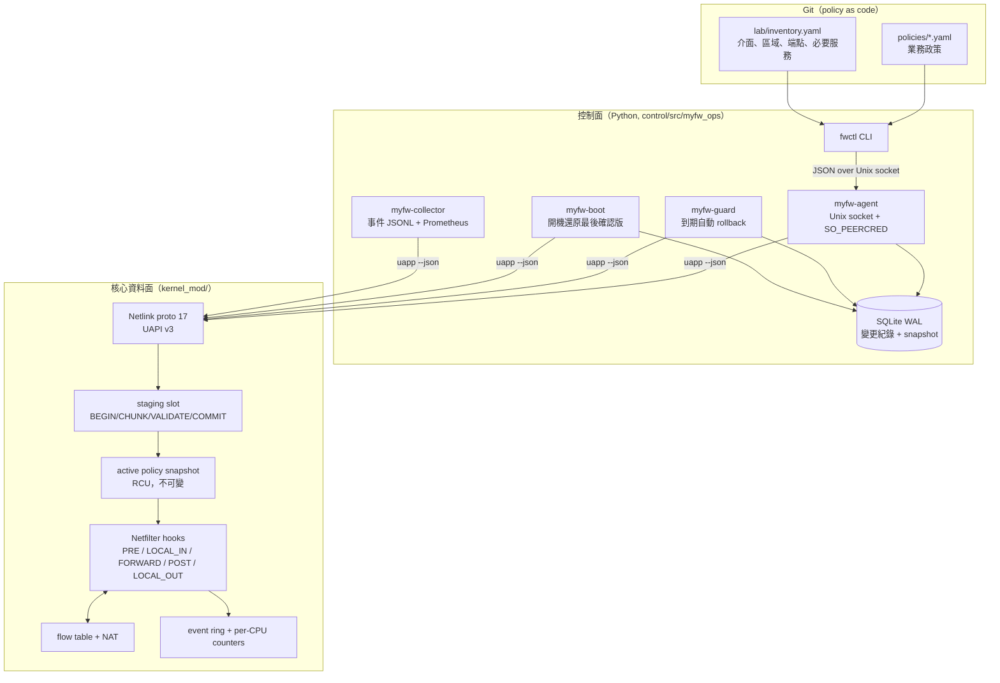
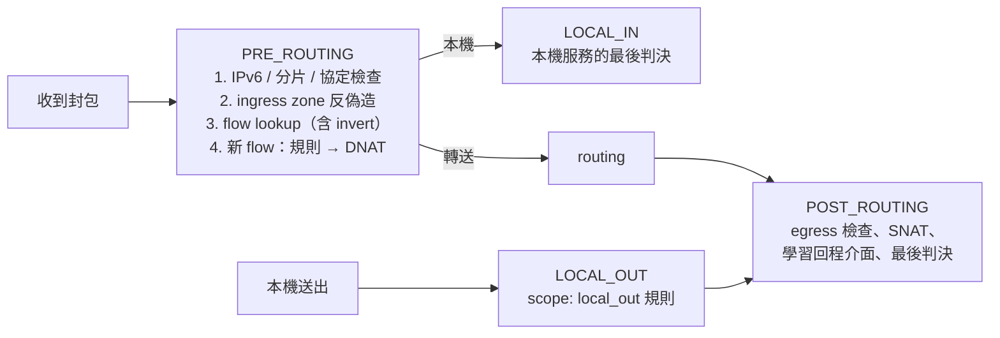

# 架構

myfw v2 把原本的「核心防火牆 + 命令列」擴充成一個**可驗證、可復原**的防火牆維運系統。核心資料面仍然是自己寫的 Netfilter 模組；新增的部分負責讓「改規則」這件事變得安全：先驗證、整份原子切換、跑服務探測、沒確認就自動退回。

## 分層



| 元件 | 職責 | 權限 |
|---|---|---|
| `kernel_mod/` | 封包判斷、狀態追蹤、NAT、原子切換政策、計數與事件 | 核心 |
| `cmd/uapp` | Netlink 客戶端；`--json` 是控制面唯一使用的介面 | `CAP_NET_ADMIN` |
| `fwctl` | 操作者 CLI：validate / diff / apply / confirm / rollback / verify / status / history / events / diagnose | 群組 `myfw`（寫）或 `myfw-read`（讀） |
| `myfw-agent` | 唯一能改政策的常駐程式；列舉的操作 + 固定參數格式，用 `SO_PEERCRED` 判斷呼叫者 | `CAP_NET_ADMIN CAP_SYS_ADMIN`（netns 探測） |
| `myfw-guard` | 每秒檢查未確認變更，到期就 rollback；sd_notify watchdog | 只有 `CAP_NET_ADMIN` |
| `myfw-boot` | 開機時載入模組、套用最後確認版，**之後**才打開 IP forwarding | root，一次性 |
| `myfw-collector` | 讀事件游標寫 JSONL（含 gap 紀錄）、提供 `127.0.0.1:9108/metrics` | 非特權使用者 |

三個寫入者（agent / guard / boot）共用同一個 `transactions.py`，所以任何一個活著都能用同樣的規則完成交易。agent 掛掉時資料面照常運作，guard 也照樣能 rollback（`test_agent_crash_does_not_stop_the_data_plane_or_the_guard`）。

## 資料面

### 封包路徑



- **ingress zone**：每個區域綁一個介面（ifindex）與允許來源網段。來源不在該區域網段內的封包在查 flow 之前就丟掉（`spoofed_source`），所以偽造來源打不進已存在的 flow。
- **flow 綁介面**：每個 flow 記錄兩個方向「應該從哪個介面進來」。回程介面在 POST_ROUTING（轉送）或 LOCAL_IN（本機）學習。從錯的介面進來 → `flow_interface`。
- **NAT**：PRE 做 DNAT、POST 做 SNAT；因為封包在 PRE 已被改寫，POST 查 flow 時也試反向 tuple（`__find_pkt`），否則會誤判 `nat_state_missing`。
- **fail closed**：flow table 滿、記憶體不足、SNAT pool 用完、找不到 NAT 狀態、出口不符、分片、不支援的協定都 **DROP 並記錄原因**；原版在 flow table 滿時會「放行但不追蹤」。
- **一個封包只有一個最終判決**：只在 POST_ROUTING LAST 與 LOCAL_IN LAST 計入 accept/drop，中間 hook 的 drop 直接計入。`test_counters_have_one_final_verdict_per_packet` 驗證「accept + drop 增量 = 實際送出的封包數」。

### 政策 snapshot 與 generation

政策不是一條一條改，而是**整份**送進核心：

1. `STAGE_BEGIN(size, sha256)` 取得唯一的 staging slot（屬於該 Netlink socket）。
2. `CHUNK` 分段寫入。
3. `VALIDATE`：核心重新驗證每個欄位與 sha256（不信任使用者空間）。
4. `COMMIT(expected_generation)`：generation 不符就回 `ESTALE`，兩個寫入者只會有一個成功。
5. 切換：開 gate → `rcu_replace_pointer` → `synchronize_rcu_expedited` → 關 gate → 清掉舊 generation 的 flow。

每個封包在 PRE 把當時的 generation 寫進 `skb->mark`；後面的 hook 若發現 generation 已變就丟掉（`generation_mismatch`），所以**沒有封包會一半用舊政策、一半用新政策**。staging 中斷（程式被殺、socket 關閉、逾時）會由 `NETLINK_URELEASE` notifier 或 delayed work 釋放，active 政策不受影響。

詳細的交易語意見 [transaction-design.md](transaction-design.md)，政策欄位的語意見 [policy-semantics.md](policy-semantics.md)。

## 控制面狀態

`/var/lib/myfw/state.db`（SQLite WAL）保存：

- `changes`：每次變更的狀態 `prepared → pending → confirmed / rolled_back / failed / noop`、deadline、generation、diff、原因。
- `audit`：誰（uid）在什麼時候做了什麼。
- `snapshots`：以語意 hash 為 key 的 canonical 政策，rollback 與開機還原直接取用。
- `meta.last_confirmed_hash`：最後已知良好的政策。

寫入都在 `flock` 狀態鎖之內，所以 CLI、agent、guard 同時動作也只會有一個交易在進行。

## Lab 拓樸

```
             mgmt0 10.0.2.15/24（管理，SSH）
                        │
   lan ns ──veth-lan── [gateway：myfw] ──veth-wan── wan ns
 10.10.10.10   10.10.10.1      │       192.0.2.1    192.0.2.10
 (lan-client)                  │                     (wan-host, HTTPS)
                         veth-dmz 10.10.20.1
                               │
                            dmz ns 10.10.20.10（dmz-web, HTTPS）
```

存取矩陣（`lab/inventory.yaml` 的 10 個 probes）：

| 從 | 到 | 預期 |
|---|---|---|
| lan-client | dmz-web:443 | 允許 |
| lan-client | wan-host:443 | 允許，wan-host 看到的來源是 192.0.2.1（SNAT） |
| wan-host | 192.0.2.1:8443 | 允許，DNAT 到 dmz-web:443，dmz-web 看到真實外部位址 |
| wan-host | dmz-web:443（直連） | 拒絕 |
| wan-host | 192.0.2.1:8080 | 拒絕 |
| dmz-web | lan-client:8080 | 拒絕 |
| lan-client | gateway SSH、管理網 SSH | 拒絕 |
| wan-host | gateway SSH | 拒絕 |
| lan-client | dmz-web:8443 | 拒絕 |

HTTPS 測試服務會回報它看到的 client 位址，所以 NAT 是否正確可以從伺服器端直接證明。
