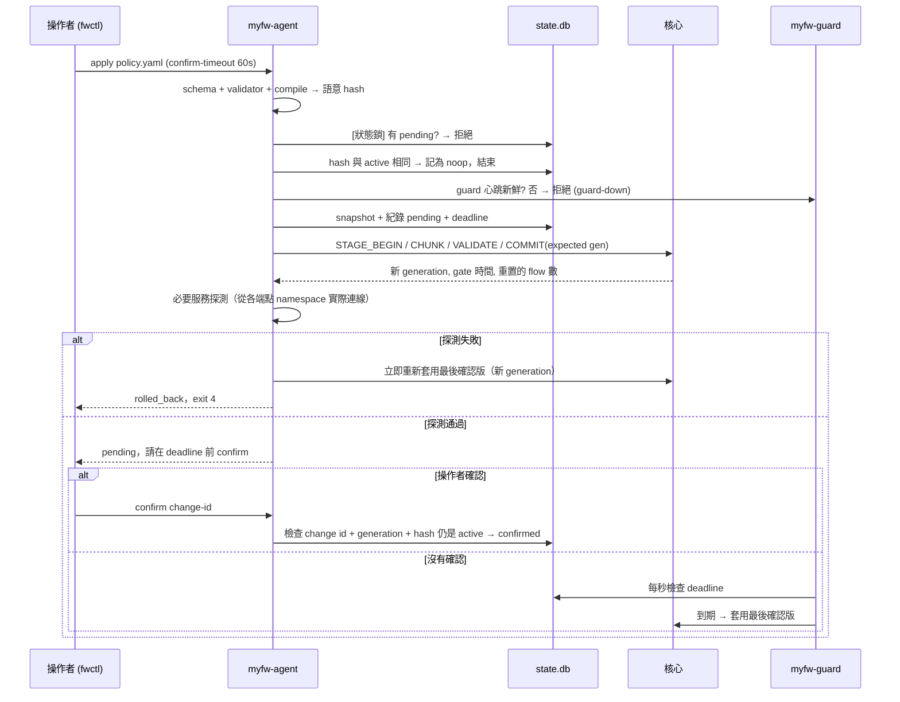

# 變更交易設計

目標只有一個：**任何一次改規則，結果都只會是「新政策完整生效並被確認」或「回到最後確認版」，不會停在半套。**

## 一次變更的生命週期



## 關鍵決策

### 1. 先記錄 pending，再 commit 到核心

如果反過來（先 commit 再記錄），在兩步之間當機就會留下一個「核心裡有、紀錄裡沒有」的政策，沒有人知道要 rollback。現在的順序保證：只要核心裡有未確認的政策，資料庫裡一定有對應的 pending 紀錄和 deadline。

### 2. rollback 是一次新的 commit

rollback 不是「還原上一個指標」，而是把最後確認版的 snapshot 當成一個**新的 generation** 再 commit 一次。好處是核心只有一種切換路徑（同樣的驗證、同樣的 gate），generation 永遠遞增，事件與計數也不會倒退。代價是：forward 變更時被重置的 TCP/NAT session，rollback 後不會復活，只有新連線能用。

### 3. 確認要對上 change id、generation 和 hash

`confirm` 會檢查該變更仍然是核心目前的 generation 與 hash。若中間有人 rollback 或套了別的政策，確認會被拒絕（`stale`），避免「確認了一個已經不在線上的東西」。

### 4. 沒有 guard 就不准改

未確認的變更只有 guard 能在操作者斷線時把它退回。所以 guard 心跳不新鮮時，`apply` 直接拒絕（`guard-down`）。guard 被 systemd 監控（`WatchdogSec`），被殺掉會自動重啟（`test_guard_is_restarted_and_apply_refuses_without_it`）。

### 5. 復原不只是記憶體裡的 timer

deadline 存在資料庫，不在任何程式的記憶體裡：

| 情況 | 誰完成 rollback | 測試 |
|---|---|---|
| 操作者沒確認 | guard（每秒檢查一次）；TCG VM 實測 deadline 後 1.2–3.7 秒完成 | `test_unconfirmed_change_is_rolled_back_by_the_guard` |
| 必要服務探測失敗 | agent，立即 | `test_failed_required_service_rolls_back_immediately` |
| agent 被 kill -9 | guard（不需要 agent） | `test_agent_crash_does_not_stop_the_data_plane_or_the_guard` |
| pending 時重開機 | myfw-boot：開機套用最後確認版，**之後**才打開 forwarding，並把 pending 標為 rolled_back | `test/integration/reboot_pending.py` |

### 6. 一次只有一個寫入者

- 使用者空間：`flock` 狀態鎖 + 「有 pending 就拒絕新的 apply」（連 no-op 也拒絕，避免別人看到 ok 以為自己的變更生效了）。
- 核心：`COMMIT(expected_generation)`；兩個 `uapp policy apply` 同時送同一個 generation，只有一個成功，另一個收到 `ESTALE`（`test_two_writers_one_generation`）。

## 核心切換的細節

```
gate on  → 新 flow 的第一個封包暫時 DROP（update_gate），既有 flow 照常
rcu_replace_pointer(active, new)
synchronize_rcu_expedited()   ← 等所有還在用舊 snapshot 的 CPU 離開
gate off
清掉 generation != new 的 flow
```

- **gate 很短**：在 TCG 模擬的 VM 裡，持續流量下 20 次 commit 的 gate 中位數 0.55–1.9 ms、最大 5–7.7 ms（兩輪）（`/var/lib/myfw-tests/commit-under-load.json`）。期間被擋的新連線第一個 SYN 會由 TCP 重傳補回。
- **為什麼要清 flow**：新政策可能已經不允許某個既有連線，或 NAT 規則改了。逐一用新政策重新判斷每個 flow 是更好的做法，但首版選擇簡單且保證正確的方式：舊 generation 的 flow 全部重置，`apply` 的結果會報告 `flows_reset`，`diff` 也會事先警告。語意相同的重新套用是 no-op，不會重置任何 flow。
- **跨 hook 一致**：PRE 把 generation 寫進 `skb->mark`，NAT 與最終判決的 hook 發現不符就丟（`generation_mismatch`）。因此 myfw 擁有本機的 `skb->mark`，不能和其他使用 fwmark 的工具共存。

## staging 的失敗處理

| 情況 | 結果 |
|---|---|
| blob 被截斷、亂碼、sha256 不符 | VALIDATE 失敗，active 不變（`test_invalid_candidates_never_touch_the_active_policy`） |
| 寫到一半程式被殺 / socket 關閉 | `NETLINK_URELEASE` 立刻釋放 slot |
| 寫到一半卡住 | `stage_timeout`（預設 30 秒）後 delayed work 釋放 |
| 另一個 socket 想同時 staging | `EBUSY` |

`uapp policy apply --debug-stop-after-chunks N` 可以重現中斷（`test_interrupted_staging_is_released`）。

## 舊指令

原版的 `uapp rule/nat/zone add|del` 仍然可用，但每一次都會把「目前的整份政策 + 這個修改」當成一個新 generation commit。受管理模式下（政策由 fwctl 套用）舊指令會被拒絕，避免繞過驗證與 rollback；需要時加 `--force-legacy`，fwctl status 會顯示 `in_sync: false`。
